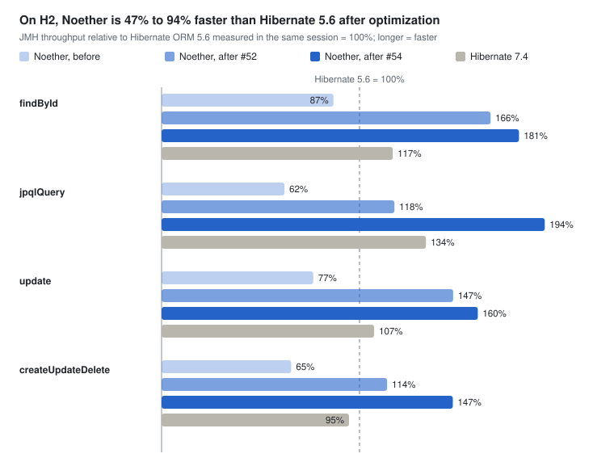
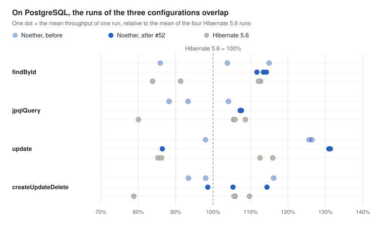

# Noether audit — report

2026-11-11 · tracking issue [Vidocq/noether#45](https://codefloe.com/Vidocq/noether/issues/45)

Noether is sound at its core: strict Java Modules, generated entity access, a portable CDI extension. The audit
found blocking defects on application servers and on Quarkus, and a performance gap against Hibernate 5.6: all of
them are fixed. In pure provider work, measured on in-memory H2, Noether is now 47% to 94% faster than
Hibernate 5.6 and allocates less memory. On PostgreSQL, the database's input/output is the limit, and both
providers reach the same level. Every fix is proposed on the `fix-proposals` branch. The maintainer decided the
open points on 2026-11-11, and those decisions are applied on the same branch; merging it into `main` is still to
be decided.

## Verdict per axis

The seven axes are compliant or fixed, and the upstream fixes, Vauban #285 and Mansart #93, are merged.

| Axis | Expected | Finding | State | Pull requests |
|---|---|---|---|---|
| A1 Architecture | Coherent modules, strict Java Modules, a brick depends on APIs | Sound split: core, dialect SPI and dialects, APT processor, CDI, JTA bridge. Only the `spi` package is exported without qualification, no unqualified `opens`. The four open points are decided and applied: Mansart is out of the core (F7) and of the CDI bridge (F4), JDBC work runs on the calling thread (F6), and only the core reads `persistence.xml` (F12). | Compliant | [#60](https://codefloe.com/Vidocq/noether/pulls/60), [#61](https://codefloe.com/Vidocq/noether/pulls/61), [#63](https://codefloe.com/Vidocq/noether/pulls/63) |
| A2 Reflection | The specification minimum, nothing per row | `SELECT NEW` and `@ConstructorResult` looked their constructors up on every row (F3). The rest is the specification minimum (F8). | Fixed | [#49](https://codefloe.com/Vidocq/noether/pulls/49) |
| A3 Static generation | APT and the Class-File API | Entity access, listeners, converters and the canonical metamodel are generated. No gap a generator would fill. | Compliant | — |
| A4 The most in the build compatible extension | A portable CDI Lite extension, no container-specific path | Entirely a build compatible extension. It broke on ArC and visited every class; fixed. On Vauban, the build-time path broke on two Vauban bugs (F9), fixed by Vauban #285, merged. A binding-key collision is fixed (F13). | Fixed | [#48](https://codefloe.com/Vidocq/noether/pulls/48), [#50](https://codefloe.com/Vidocq/noether/pulls/50), [#51](https://codefloe.com/Vidocq/noether/pulls/51), [Vauban #285](https://codefloe.com/Vidocq/vauban/pulls/285) |
| A5 Open Liberty | Noether as the provider of a WAR, with the server's JTA | A JTA unit was refused at bootstrap: there was no bridge for a Jakarta EE server (F1). New module `noether-jpa-jta`. TABLE identifiers then failed on the server's enlisted connection (F18): they now go through the unit's non-JTA data source. | Fixed | [#47](https://codefloe.com/Vidocq/noether/pulls/47), [#65](https://codefloe.com/Vidocq/noether/pulls/65) |
| A6 Quarkus | ArC and Narayana, without Hibernate ORM | Two defects of the extension on ArC (F11), fixed with portable CDI. Noether now takes Quarkus' own pieces, the Agroal data source and Narayana's `TransactionSynchronizationRegistry` (F10), with no Mansart jar in the application; 16 Quarkus tests. | Fixed | [#48](https://codefloe.com/Vidocq/noether/pulls/48), [#63](https://codefloe.com/Vidocq/noether/pulls/63), [#65](https://codefloe.com/Vidocq/noether/pulls/65) |
| A7 Performance | At least Hibernate 5.6 | On H2: 13% to 38% below Hibernate 5.6 at the start (F2), 47% to 94% above after optimization, with less allocation on all four workloads. On PostgreSQL: at the same level, within the run-to-run variation. | Fixed | [#46](https://codefloe.com/Vidocq/noether/pulls/46) (measurement), [#52](https://codefloe.com/Vidocq/noether/pulls/52), [#53](https://codefloe.com/Vidocq/noether/pulls/53) (PostgreSQL), [#54](https://codefloe.com/Vidocq/noether/pulls/54) (allocation) |

## Proposed fixes

Nine pull requests target `fix-proposals`; the Vauban and Mansart ones are already merged. Each defect was first
proven by a failing test, then fixed; each optimization is measured before and after.

| Pull request | Topic | Defect proven before the fix | Local validation |
|---|---|---|---|
| [#46](https://codefloe.com/Vidocq/noether/pulls/46) | Hibernate ORM 5.6 added to the JMH bench | None: this is the reference measurement | Run BENCH-20261111-01 |
| [#47](https://codefloe.com/Vidocq/noether/pulls/47) | Noether on Open Liberty, new module `noether-jpa-jta` | Liberty IT red: JTA unit refused at bootstrap (BUG-20261111-01) | Liberty IT 3/3, JTA bridge 7/7, reactor 1185 tests |
| [#48](https://codefloe.com/Vidocq/noether/pulls/48) | Noether on Quarkus, the CDI extension on ArC | Quarkus test red: qualifier unknown to ArC, then factory bean removed (BUG-20261111-02) | Quarkus test 3/3, reactor 1188 tests |
| [#49](https://codefloe.com/Vidocq/noether/pulls/49) | Result constructors read once per class | New failing unit test | 5 new tests, reactor 1180 tests |
| [#50](https://codefloe.com/Vidocq/noether/pulls/50) | The extension run at build time on Vauban; instruction added to the usage page | Red test: no persistence injection resolved (BUG-20261111-03, cause in Vauban) | Red before Vauban #285, 5/5 on Vauban `main` since its merge |
| [Vauban #285](https://codefloe.com/Vidocq/vauban/pulls/285) | Build-time synthetic-bean qualifiers keep their members; a patch for a class outside the deployment is ignored | 5 Vauban tests red on `main` | 7 new tests, 2097 Vauban tests; CI (19 consumers) and SonarQube green, merged |
| [#51](https://codefloe.com/Vidocq/noether/pulls/51) | One binding key per persistence-context configuration | BUG-20261018-03, left open by an earlier review: 2 collisions proven | 3 new tests, reactor 1191 tests |
| [#52](https://codefloe.com/Vidocq/noether/pulls/52) | Hot paths: connection returned to the pool in auto-commit mode, one state read per flush, shared query plans, one-pass load | JFR profile: the pool's reset rollback was 27% of `findById`'s allocation | 12 new tests, reactor 1187 tests; BENCH-20261111-04 |
| [#53](https://codefloe.com/Vidocq/noether/pulls/53) | The bench on any database, PostgreSQL 17 campaign | None: every earlier measurement was on H2 | 10 runs in 3 rounds; BENCH-20261111-05 |
| [#54](https://codefloe.com/Vidocq/noether/pulls/54) | Allocation below Hibernate 5.6: a persistence context without a wrapper per instance, flush lists made only when there is something to write, no shared-cache bookkeeping when no entity goes there, one form for a fetched row | Measurement: after #52, Noether still allocated 1.23 times Hibernate 5.6 on the full cycle and 1.32 times on the JPQL query (BENCH-20261111-04) | 6 new tests, reactor 1193 tests; BENCH-20261111-06 to -08 |

Pull requests into `fix-proposals` do not trigger the CI, so each was validated locally. The nine were then
validated together: chained in their merge order, they pass `./mvnw clean verify` with 1215 tests and no failure,
against the latest Vauban and Mansart snapshots (Vauban #285 and Mansart #93 included). The pull request from
`fix-proposals` into `main` runs the full validation and SonarQube.

### After the review

Nine more pull requests followed, merged into `fix-proposals` the same day:

| Pull request | Topic | Local validation |
|---|---|---|
| [#57](https://codefloe.com/Vidocq/noether/pulls/57), [#58](https://codefloe.com/Vidocq/noether/pulls/58), [#59](https://codefloe.com/Vidocq/noether/pulls/59) | The SonarQube issues of the pull request into `main`: 58 reported over three analyses, 47 fixed in code, 11 resolved in SonarQube with their reason | 1215 tests; BENCH-20261111-09: no throughput change |
| [#60](https://codefloe.com/Vidocq/noether/pulls/60) | F6, F12: JDBC work on the calling thread, one `persistence.xml` parser; the evidence that F14's first option reuses identifiers | 1224 tests |
| [#61](https://codefloe.com/Vidocq/noether/pulls/61) | F7: the Mansart pool becomes the optional module `noether-jpa-pool-mansart` | 1237 tests; BENCH-20261111-10 |
| [#62](https://codefloe.com/Vidocq/noether/pulls/62) | F14: a TABLE generator refuses a Noether pool below 2 connections at bootstrap | 1248 tests |
| [#63](https://codefloe.com/Vidocq/noether/pulls/63) | F4, F10: JTA units on a CDI container use the container's registry and data source; Quarkus on Agroal and Narayana. Fixes BUG-20261111-05: Agroal warned at every commit, a connection is now given back after each unit of work | 1273 tests, Quarkus 15 |
| [#65](https://codefloe.com/Vidocq/noether/pulls/65) | F18: TABLE identifiers of a JTA unit through its non-JTA data source | 1284 tests, Open Liberty 5, Quarkus 16 |
| [#64](https://codefloe.com/Vidocq/noether/pulls/64) | F15: Noether owns `Entity_` beside the real Mansart Data processor, after [Mansart #95](https://codefloe.com/Vidocq/mansart/pulls/95) | 1285 tests |

Each was validated locally before its merge; the head of `fix-proposals` passes `./mvnw clean verify` with 1285
tests and no failure. The test of [#64](https://codefloe.com/Vidocq/noether/pulls/64) found one more Mansart Data defect, BUG-20261111-06: its `_Entity` does
not compile for an entity with a collection field. It is reported to Mansart; the test works around it.

## Performance against Hibernate 5.6

On in-memory H2, the optimizations of #52 put Noether ahead of Hibernate 5.6 on all four workloads, where it was
behind on all of them; the allocation work of #54 widens the gap.

*BENCH-20261111-01 (before, Hibernate 7.4), -04 (after #52) and -07 (after #54) · JMH, Apple M5 Max,
Temurin 25.0.3, in-memory H2*

The largest gain comes from one point. Noether returned its connection to the pool out of auto-commit mode, the
pool reset it with a rollback, and that rollback emptied H2's statement cache, so every query was parsed again.
The rest comes from one state read per flush, query plans shared by the factory, and a one-pass load of the
entities without relationships. Two limits: the bench has a single entity without relationships, so the gain on a
relational model remains to be measured; and Hibernate 7.4 was not measured again, its bars come from the first
session.

Allocation remained: after #52, Noether still allocated more than Hibernate 5.6 on the JPQL query and the full
cycle. #54 removes intermediate objects in three places:

- the persistence context: a wrapper and a table entry per instance;
- the flush: lists and copies made even when there is nothing to write, and shared-cache bookkeeping when no
  entity goes there;
- the fetched rows: several intermediate objects and duplicate keys per row.

Noether now allocates 17% to 45% less than Hibernate 5.6 on all four workloads, and its throughput gains another
13% to 64% over #52.

Bytes allocated per operation on H2 (BENCH-20261111-04 for #52, BENCH-20261111-07 for #54 and Hibernate 5.6):

| Workload | Noether after #52 | Noether after #54 | Hibernate 5.6 |
|---|---:|---:|---:|
| `findById` | 5,534 | 4,126 | 7,486 |
| `jpqlQuery` | 34,976 | 17,488 | 26,658 |
| `update` | 12,424 | 9,896 | 13,767 |
| `createUpdateDelete` | 22,000 | 14,824 | 17,960 |

The bench was then replayed on PostgreSQL 17, before and after #52, in three rounds in different orders (#53).
On a real database, input/output is the limit: Noether and Hibernate 5.6 reach the same level.

*BENCH-20261111-05 · PostgreSQL 17.11 in a container on the same machine, JMH, Temurin 25.0.3, three rounds in
different orders*

- **Where the time goes:** the round trip to the database and the commit's `fsync` cost 130 µs to 1.1 ms per
  operation, against 1.2 to 13 µs for the provider's whole work on H2. The differences between providers fall
  within the run-to-run variation.
- **The JPQL query:** it stays clearly faster after #52, by about 9% in every run, and Noether after #52 is the
  steadiest configuration.
- **`update`:** it is bimodal for every configuration and ranks none of them.
- **Allocation:** after #54, Noether also allocates less than Hibernate 5.6 on PostgreSQL, on all four workloads
  (BENCH-20261111-08); throughput there stays at Hibernate 5.6's level.

In other words, the lead measured on H2 is the provider's code; behind a real database, input/output absorbs it.

## Architecture

The split is sound: the core exports only its `spi`, and each family of containers goes through its own bridge.

A CDI container (Vauban, Quarkus) goes through `noether-jpa-cdi`, a Jakarta EE server through `noether-jpa-jta`.
Before the decisions, Mansart entered at two points: the core required its pool (F7), and the CDI bridge installed
its transaction manager (F4). Since #61 and #63, the core has no Mansart dependency: an optional module,
`noether-jpa-pool-mansart`, brings the Java SE pool, found by `ServiceLoader`. A JTA unit on a CDI container uses
the container's `TransactionSynchronizationRegistry` and `DataSource`, as on a server. On Vidocq, the runtime
extension will bring Mansart's transactions and an enlisting data source (axis A8, to port).

## Decisions

The maintainer decided the open points on 2026-11-11; the table gives each decision and where it is applied. Only
the merge into `main` remains to decide.

| Point | Finding | Proposed option | Decision |
|---|---|---|---|
| Merging `fix-proposals` into `main` | The fixes are isolated on `fix-proposals`; nothing touched `main`. | Review the pull requests, then [#56](https://codefloe.com/Vidocq/noether/pulls/56), from `fix-proposals` into `main`, with CI and SonarQube; the merge bot fast-forwards `main` without rewriting the signed commits. | To decide |
| F7 — the Mansart pool in the core | `noether-jpa-core` depends on `mansart-pool-core`: a server or Quarkus deployment ships an unused pool. | Make the pool optional, found through `ServiceLoader`. | Accepted: new module `noether-jpa-pool-mansart`, the core has no Mansart dependency, no throughput change (BENCH-20261111-10), [#61](https://codefloe.com/Vidocq/noether/pulls/61) |
| F4 — Mansart Transactions in `noether-jpa-cdi` | The extension installs the Mansart transaction manager and its XA adapter. The Vidocq rule is that a brick depends on APIs and its runtime extension assembles. | On a container that already has JTA, go through `noether-jpa-jta`; leave Mansart to the Vidocq runtime extension. | Accepted: the container's registry and data source, [#63](https://codefloe.com/Vidocq/noether/pulls/63) |
| F6 — a thread hop per JDBC call | `JdbcExecution` moves every JDBC task to a new virtual thread and waits for it: no gain, and a server's transaction context is lost. | Run on the calling thread: the hop costs about 7 µs per call from a platform thread, five times a whole `findById` (BENCH-20261111-02). Off the bench paths, which are all transactional; it changes a documented behavior. | Accepted: `JdbcExecution` is removed, [#60](https://codefloe.com/Vidocq/noether/pulls/60) |
| F14 — TABLE generation and a one-connection pool | BUG-20261018-04, open: identifier allocation asks for a second connection while the transaction holds the pool's only one, and times out. | Allocate on the transaction's connection, or document a minimum pool size. | Accepted first, then changed: on the transaction's connection, a rollback handed the same identifiers out twice, because a block is shared by the whole factory (test in [#60](https://codefloe.com/Vidocq/noether/pulls/60)). Decided instead: keep the separate connection, and refuse at bootstrap a Noether pool below 2 connections, [#62](https://codefloe.com/Vidocq/noether/pulls/62) |
| F15 — the metamodel produced by Mansart Data | BUG-20261009-09, open: when Mansart Data writes `Entity_`, its plural attributes come out as `SingularAttribute`. | Mansart Data emits the plural kinds, or stops writing `Entity_`. | Accepted, the second: [Mansart #95](https://codefloe.com/Vidocq/mansart/pulls/95), merged; a two-processor test in [#64](https://codefloe.com/Vidocq/noether/pulls/64) |
| F10 — a native Quarkus path | On Quarkus, Noether opens its own pool and enlists in Narayana through the Mansart adapter. | Optional: the Agroal data source and the `TransactionSynchronizationRegistry`. | Accepted, with more Quarkus tests (3 to 16), [#63](https://codefloe.com/Vidocq/noether/pulls/63) |
| F12 — `persistence.xml` read twice | `noether-jpa-cdi` has its own parser to find the default unit, beside the core's. | Minor: ask the core for the default unit through the `spi`. | Accepted, [#60](https://codefloe.com/Vidocq/noether/pulls/60) |
| F17 — the Mansart pool reset | The pool reset a connection returned out of auto-commit mode with a rollback. #52 restores auto-commit before returning it, which still cost one H2 commit per transaction. | Fixed in [Mansart #93](https://codefloe.com/Vidocq/mansart/pulls/93), merged: the pool rolls back only when a statement ran since the last commit or rollback, on par with HikariCP. | Accepted |
| F18 — TABLE identifiers on a JTA unit | BUG-20261111-04, found while checking F14: the allocation went through the container's JTA data source, whose connection is enlisted in the transaction. On Open Liberty, 12 of 12 TABLE persists failed (`DSRA9250E`); after [#63](https://codefloe.com/Vidocq/noether/pulls/63), the same on Quarkus. | Allocate through the unit's non-JTA data source; refuse at bootstrap a JTA unit with a TABLE generator and none. | Accepted, [#65](https://codefloe.com/Vidocq/noether/pulls/65) |
| A8 — the Vidocq runtime extension | Missing from Vidocq's `main`: its two commits (October) stayed on a documentation branch, while the Noether README presents it as existing. | Port it onto Vidocq's `main` once #56 is merged, adapted to the Noether of this audit: `noether-jpa-jta`, one binding per configuration, the optional pool, and Mansart's transactions with an enlisting data source. Correct the README with it. | Accepted, after the merge |

## Validation and limits

Everything stated here was run locally; three checks remain before a merge into `main`.

Run on an Apple M5 Max, Temurin 25.0.3, macOS 27.2:

- The full reactor, `./mvnw clean verify`, on each branch: 1180 to 1193 tests, no failure; on the nine
  branches chained together: 1215 tests, no failure; after the decisions, on the head of `fix-proposals`: 1285
  tests, no failure.
- A real Open Liberty 26.0.0.10 (`persistenceContainer-3.2`), with the WAR packaged as an application ships it.
- A real Quarkus 3.40.1 (`@QuarkusTest`, ArC, Narayana), without `quarkus-hibernate-orm`.
- Vauban on the module path: the 4 existing scenarios and the new build-time one, red before the fix, green on
  Vauban `main` since #285 was merged.
- JMH: Noether, Hibernate ORM 5.6.15 and 7.4.12 in the same session, with the same method; after each
  optimization (#52, then #54), Noether and Hibernate 5.6 measured again together.
- PostgreSQL 17.11 in a container: Noether before and after #52 and Hibernate 5.6, three rounds in different
  orders; allocation measured again after #54.

Not run yet:

- The local SonarQube analysis: it could not be started during the audit.
- The official Jakarta Persistence TCK on the fixed branches.
- The CI runs only for pull requests into `main`: on [#56](https://codefloe.com/Vidocq/noether/pulls/56), it was
  green and the SonarQube gate passed before the decisions; it runs again on the head with them.

## Links

- [Tracking issue Vidocq/noether#45](https://codefloe.com/Vidocq/noether/issues/45): axes A1 to A8, findings F1
  to F18, state of each pull request.
- Pull requests into `fix-proposals`: [#46](https://codefloe.com/Vidocq/noether/pulls/46),
  [#47](https://codefloe.com/Vidocq/noether/pulls/47), [#48](https://codefloe.com/Vidocq/noether/pulls/48),
  [#49](https://codefloe.com/Vidocq/noether/pulls/49), [#50](https://codefloe.com/Vidocq/noether/pulls/50),
  [#51](https://codefloe.com/Vidocq/noether/pulls/51), [#52](https://codefloe.com/Vidocq/noether/pulls/52),
  [#53](https://codefloe.com/Vidocq/noether/pulls/53), [#54](https://codefloe.com/Vidocq/noether/pulls/54), then
  [#57](https://codefloe.com/Vidocq/noether/pulls/57) to [#65](https://codefloe.com/Vidocq/noether/pulls/65); in Vauban, [#285](https://codefloe.com/Vidocq/vauban/pulls/285), merged; in Mansart,
  [#93](https://codefloe.com/Vidocq/mansart/pulls/93) (F17) and [#95](https://codefloe.com/Vidocq/mansart/pulls/95)
  (F15), merged.
- [`noether-persistence/BENCH.md`](../../../noether-persistence/BENCH.md): BENCH-20261111-01 (reference), -02
  (profile), -03 (gain per commit), -04 (after optimization, H2), -05 (PostgreSQL), -06 (allocation per commit),
  -07 (after the allocation work, H2), -08 (allocation on PostgreSQL), -09 (after the SonarQube fixes), -10 (the
  optional pool).
- [`noether-persistence/BUG.md`](../../../noether-persistence/BUG.md): BUG-20261111-01 (Open Liberty),
  BUG-20261111-02 (Quarkus), BUG-20261111-03 (Vauban build time), BUG-20261018-03 (binding key, fixed),
  BUG-20261018-04 (TABLE and a one-connection pool, fixed), BUG-20261111-04 (TABLE on a JTA unit, fixed),
  BUG-20261111-05 (Agroal warning, fixed), BUG-20261009-09 (Mansart Data `Entity_`, fixed upstream),
  BUG-20261111-06 (Mansart Data `_Entity` with a collection, open upstream).
